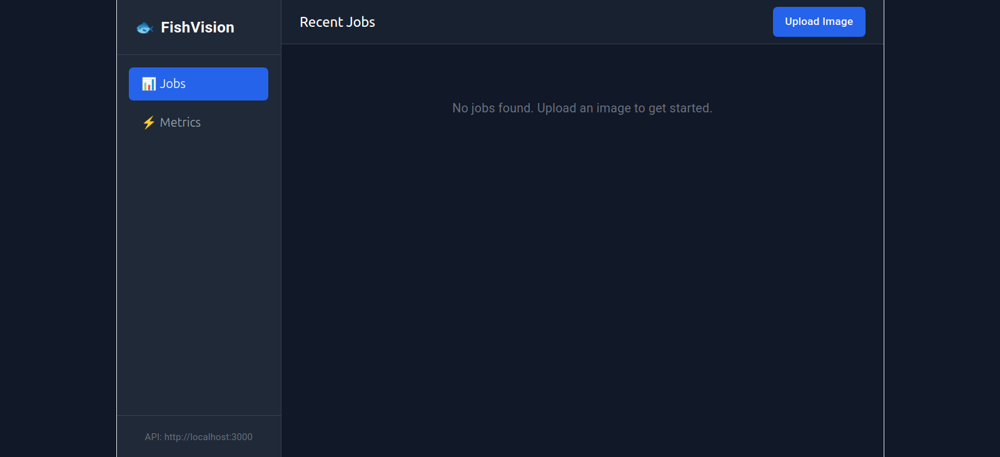
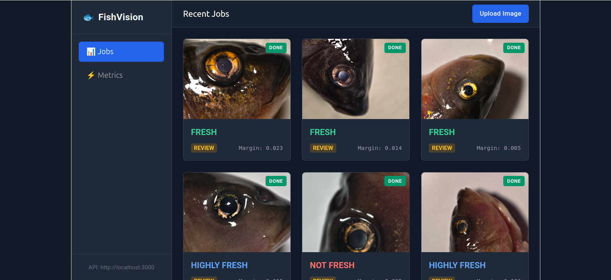
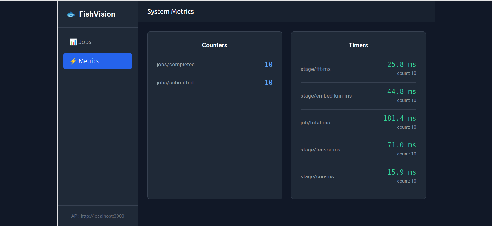

# 🐟 FishVision: Multimodal Fish Freshness Agent

> **🚧 Status: Work in Progress (Alpha) 🚧**
> This is an ongoing research and engineering project. The pipeline is fully functional end-to-end, but the underlying machine learning models are currently being iterated upon to improve cross-domain accuracy. 

FishVision is a distributed, event-driven system designed to classify fish eye freshness into three categories: **Fresh**, **Highly Fresh**, and **Not Fresh**. 

It utilizes a hybrid architecture to separate concerns: **Rust** for high-performance computer vision preprocessing, **Clojure** for agentic logic and state management, and **Svelte** for a decoupled, real-time management dashboard.





---

## 🏗️ Architecture

The system is split into four decoupled services:

1. **`fish-vision` (Rust)**: A gRPC server that uses OpenCV to process images. It extracts a 5-channel tensor (Retinex, CLAHE, LAB-b, Saturation, Sobel) and runs localized image analysis (Edge density, 2D FFT, Yellowness).
2. **`clojure-core` (Clojure)**: The central brain. It receives HTTP requests, manages a `core.async` job queue, communicates with the Rust engine via gRPC, runs the ONNX inference models (using Diamond), makes agentic decisions, and stores results in PostgreSQL.
3. **`fishvision-ui` (Svelte 5)**: A modern, decoupled frontend that polls the Clojure REST API to display a live grid of processed images, prediction margins, and system metrics.
4. **`proto`**: Shared Protobuf definitions for the gRPC communication between Clojure and Rust.

### The "Agent" & ML Pipeline
Currently, the system uses a **MobileNetV3-Small** ONNX model. However, because of domain shift (the model was trained on the FFE dataset but tested on the MFED dataset), the raw CNN logits are unreliable on new data. 

To solve this without retraining yet, the Clojure agent:
1. Extracts the 576-dimensional penultimate embedding from the CNN.
2. Uses a **k-NN Classifier (k=1)** against a reference set of 600 MFED images.
3. Calculates a confidence margin (Top-1 similarity minus Top-2).
4. Flags the job as `PASS` (if confidence is high) or `REVIEW` (if confidence is low).

---

## ⚠️ Current Limitations (Ongoing Work)

1. **Domain Shift**: The CNN easily achieves >90% on its training domain (FFE), but collapses to ~33% (guessing "Highly Fresh" for everything) on the MFED dataset. 
2. **The k-NN Workaround**: We currently rely on a k-NN classifier over frozen embeddings, which pushes MFED accuracy to **~70.8%**. This is a functional baseline, but not production-grade.
3. **Uninformative Handcrafted Features**: Extensive testing showed that the Rust-extracted features (Edge Density, Yellowness, FFT) have very low Cohen's *d* (< 0.25) on MFED. They are currently logged as metadata but *are not used* for the final decision.
4. **No OOD Detection**: The system currently has no "Unknown" class. If you upload a picture of a car, it will confidently guess a fish freshness class (though the margin threshold will likely flag it for `REVIEW`).

---

## 🚀 Getting Started (Local Development)

### Prerequisites
- **Java 11+** (Clojure)
- **Rust** (Cargo)
- **Node.js 18+** (Svelte)
- **PostgreSQL** (running on `localhost:5432`)
- **OpenCV** (`libopencv-dev` on Ubuntu)

### 1. Database Setup
Create a database named `fishvision`. The Clojure app will automatically create the required tables on startup.
```sql
CREATE DATABASE fishvision;
```
## 📚 Datasets and Licensing

This project was developed and evaluated using the following publicly available datasets.

### 1. MFED (Multistage Fish Eyes Dataset)
- **Source**: Yan, Ce. (2026). *Multistage Fish Eyes Dataset* (Version 2) [Data set]. Mendeley Data. https://doi.org/10.17632/67nmx3mhwh.2
- **License**: **CC BY 4.0** (Creative Commons Attribution 4.0 International).

### 2. FFE (Freshness of Fish Eyes Dataset)
- **Source**: Originally created by Eko Prasetyo et al. (2022) and distributed via Mendeley Data. A version of this dataset is hosted on Kaggle by user `huytu2025`.
- **License**: The license for this specific distribution is listed as **"Unknown"** on Kaggle. This dataset was used for research and benchmarking purposes only, in accordance with the terms of its original publication.

